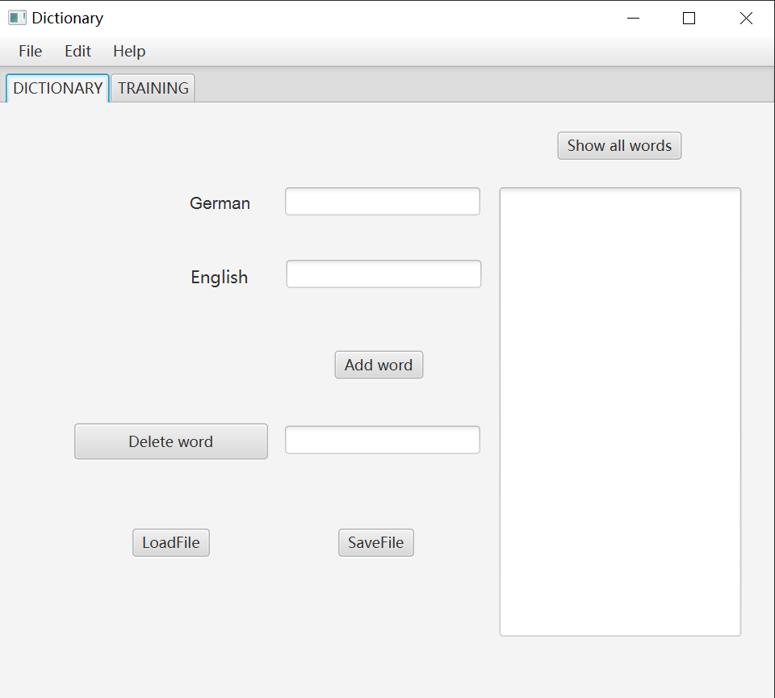
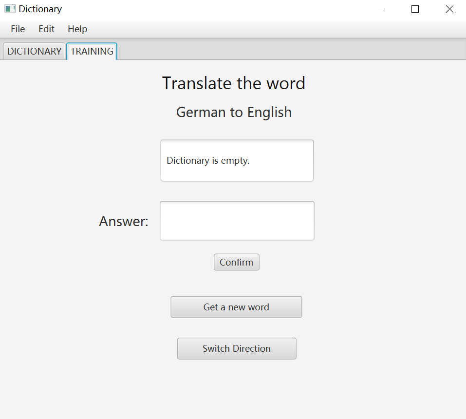

# German-English Dictionary

A JavaFX desktop application for managing and practicing German-English vocabulary.

## Features

- Add German-English word pairs
- Delete vocabulary entries
- Display stored vocabulary
- Save and load vocabulary from files
- Practice vocabulary in training mode
- Switch between German-to-English and English-to-German training
- Handle invalid input and file formats

## Screenshots

### Dictionary


### Vocabulary Training


## Tech Stack

- Java
- JavaFX
- Gradle
- JUnit 5
- FXML

## Project Structure

The project follows the MVVM (Model-View-ViewModel) pattern to separate the user interface from application logic. File persistence is handled by a separate DAO class.

- `Dictionary` - manages vocabulary entries
- `Wordpair` - represents a German-English word pair
- `DictionaryDAO` - handles saving and loading dictionary data
- `Training` - provides vocabulary training logic
- `MainController` - handles JavaFX UI interactions
- `MainViewModel` - connects the UI with application data

## Data Persistence

Vocabulary is stored in memory during runtime.
Users can save and load dictionaries as text files.

Each line contains a German-English word pair
separated by a colon.

Example:

```text
Hund:dog
Katze:cat
Haus:house
```

## Testing

JUnit tests cover:

- Adding and deleting vocabulary
- Empty and duplicate entries
- File saving and loading
- Invalid file formats
- Training direction
- Answer checking

### Requirements

- JDK 25(as specified in `app/build.gradle`)
- Gradle Wrapper (included in the project)

## Run the Project

On Windows PowerShell:

**Run the application:**

```powershell
.\gradlew.bat run
```

**Run unit tests:**

```powershell
.\gradlew.bat test
```

**Build the executable JAR:**

```powershell
.\gradlew.bat jar
```